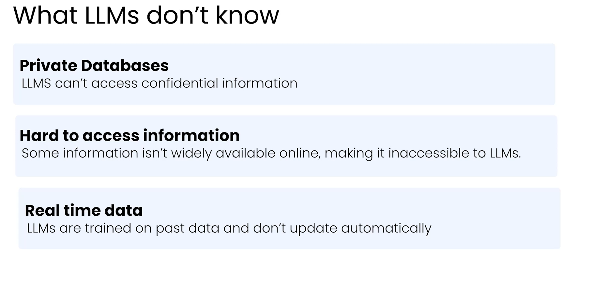
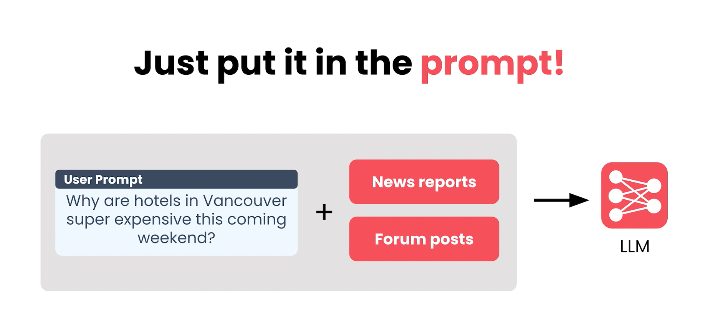

# Context Engineering

Large language models are powerful, but without access to the right information, they often make mistakes. RAG (Retrieval Augmented Generation) fixes that by grounding model responses in relevant, often private or up-to-date data. As LLMs move into real products and workflows, the ability to build robust, reliable RAG systems is becoming a must-have skill for engineers working in AI.

RAG is at the core of LLM systems that need to be accurate, grounded, and adaptable, whether for internal tools, customer-facing assistants, or specialized applications. This course helps you move beyond proof-of-concept demos into real-world deployment, equipping you with the skills to build, evaluate, and evolve RAG systems as the ecosystem grows.

## RAG (Retrieval Augmented Generation)

### Module - 1 : RAG Overview

#### 1. Introduction to RAG
    RAG is the approach that further improves the LLMs by giving them access to information that they dont know from their training.

1. The process of collecting usefull information is called **"Retrieval"** .
2. The process of reasoning over that information and responding is called **"Generation"**

All LLMs are not know whole things like, private database, the data which is not exposed publically. So how we can do that?

we can give along with the prompt.

RAG Also do the same thing, everytime adding the relevant data in the prompt is difficult, so giving access to the relevant data.

And when user prompt something related to that data:
    step 1: Perform a retrieval step to gather relevant information  - RAG System
    step 2: The LLM would then provide an **"Augmented Prompt"** that includes both the original question and any retrieved information.

    Now the LLM has the information it needs to respond accurately.

The component of the RAG System that handles Retrieval is called **"Retriever"**

#### 2. Application of RAG

#### 3. Architecture of RAG

#### 4. Introduction to Information retrieval

    The purpose of the retriver is need to provide useful information to the LLM that was potentially not available when the modal was trained.

    Next step is the actually Retrieve relevant information

Inside a RAG System 
    1. Needs to process the prompt to understand the underlying meaning
    2. Then it uses the understandings to search the index of the document
    3. Retriever then returns the documents from the database which is most relevant to the prompt.
    4. When its completing its search the retriever ranks documents in the knowledge base by how relevant they are to the prompt. Each document recieves a numerical score that quantifies its relevant. (usually this will be the similarities with the text on the prompt as text on the document).
    5. The documents with the highest scores are the ones that are returned.

### Module - 2: Information Retrieval and Search Foundation

#### Retriever Architecture Overview

The modern retriever has two approaches commonly for fetching the relevant information

**Hybrid Search:**
It relys on multiple technique to produce its final document ranking.

#### Semantic Search Introduction
Semantic search is able to match documents to prompts based on shared meaning and can capture new answers that keyword search misses.

**Semantic search vs keyword search (almost similar in the highlevel)**

* Every document is mapped to a vector and so as prompt.
* Then the prompt vectors and document vectors are compare generate a scores and find the documents are most closely matched to the prompt.
* The primary difference is the way the vectors are assigned to each documents and prompt.
    * **Keyword search** : just counting how often each word appears in the peice of text.
    * **Semantic search**: Generate vectors by running the prompt or document through a special mathematical model called embedding model.Embedding model map words to a location in space. This location is represented by a vector. The embedding models map semantically similar words near by locations in space.

How the distance measure is used to power the semantic search?

1. All the documents are projected in the vector space by the embedding model (embedding model will do the documents with similar meaning closer together and documents with disimilar meaning will be further apart.)
2. Embedded the prompt to get the prompt vector and placed in the vector space using the same embedded model.
3. Now we can measure the distance between the prompt vector and measure of each document
4. Ranks the documents based on the distance, if the distance is very low have the highest ranks and vice versa.

#### Semantic Search - Embedding model Deepdive

An Embedding model job is fairly simple to describe. It needs to embed similar text to vectors that are closed to one another and dissimilar text to vectors that are further apart.

**Positive and Negative pairs**

positive pair - two peices of similar text/meaning
negative pair - two peices of dissimilar text/meaning

embedding model should work to place the postive pairs to closer together and negative pairs to further apart.

The first step of training an embedded model is compiling a large collection of positive and negative pairs also called examples.

#### Hybrid Search

