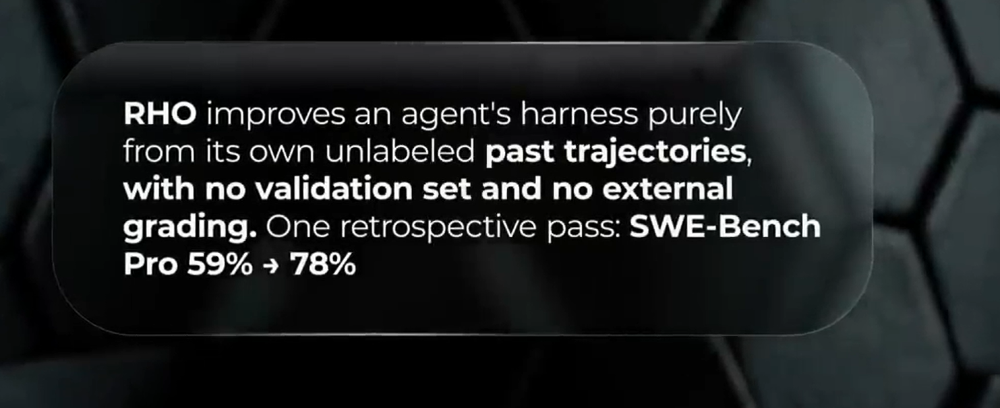
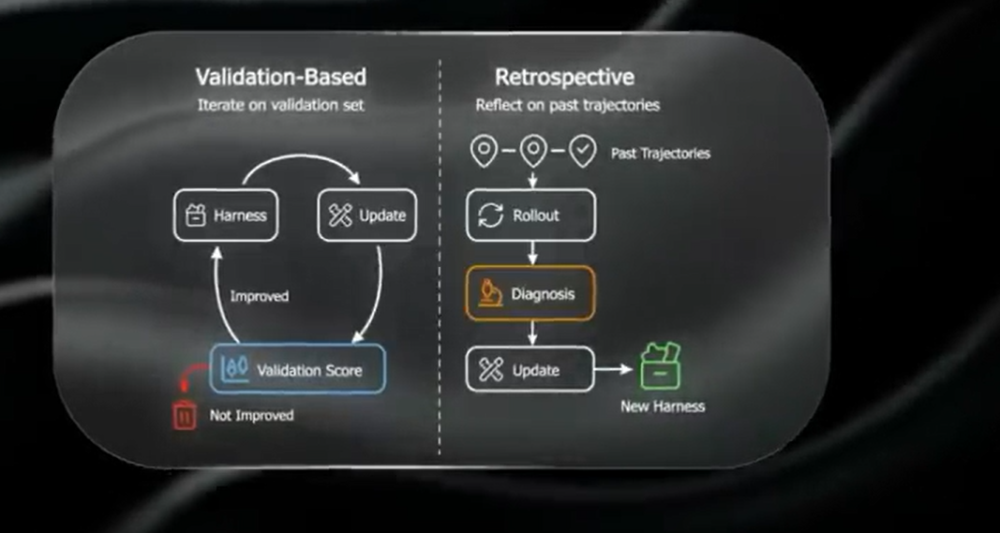

# Harness Engineering

    The evolution of AI interaction has moved from Prompt Engineering to Context Engineering, and has now firmly arrived at Harness Engineering. The fundamental equation for modern autonomous systems is simple: Agent = Model + Harness.

### The 7 Layers of the ETCLOVG Taxonomy

    To systematically understand and build these systems, the ETCLOVG taxonomy breaks down the harness into seven distinct architectural layers:

#### 1. Execution Environment (Sandboxing): 
    The isolated, reproducible environment where an agent's actions run. Prevents unintended side effects or security breaches on host systems.

#### 2. Tool Interface: 
    The governance of how agents discover, select, and invoke external systems. Includes API routing, rate limits, and error feedback.

#### 3. Context & Memory: 
    The discipline of curating exactly what the model sees. Manages short-term session state, persistent memory, and context compaction.

#### 4. Lifecycle & Orchestration: 
    The control center. Manages think-act-observe loops, task decomposition, retry logic, and multi-agent coordination.

#### 5. Observability: 
    The telemetry system. Records execution traces, logs tool invocations, and captures the step-by-step provenance to diagnose failures.

#### 6. Verification & Evaluation: 
    The feedback loop. Connects tasks to computational sensors (linters) and inferential sensors (LLM-as-a-judge) for intermediate validation.

#### 7. Governance & Security: 
    The administrative guardrails. Defines execution permissions, identities, Human-in-the-Loop approval gates, and audit trails.

## Difference btw Prompting, Context and harness

1. If we change the words that model directly reads, that is prompt work.
2. If we change what information in the model recieves that is context work.
3. If we change the invisible struture around the model like the tools it can call, the checks it must pass, the memory it can trust, the permission it has and the recovery process if something goes wrong that is harness work.

### RHO - Restrospective Harness Optimization

    The way for agent to improve its harness by looking back to its own past work.

