# Finding Information

## 1. Pretrained knowledge - knowledge from internet ( wikipidea, reddit, quora, etc..)
    This is not enough for all the application, including those that need real time information.

## 2. Web Search
    Consider a GPT model released on 2024 and in the pretrained knowledge also till 2024. So if any information we want to know after this cut of line, the model will check initially on pretrained knowledge and it is not found it will do a web search. (like the question is what is the rate for enfield new model in 2026?)

 

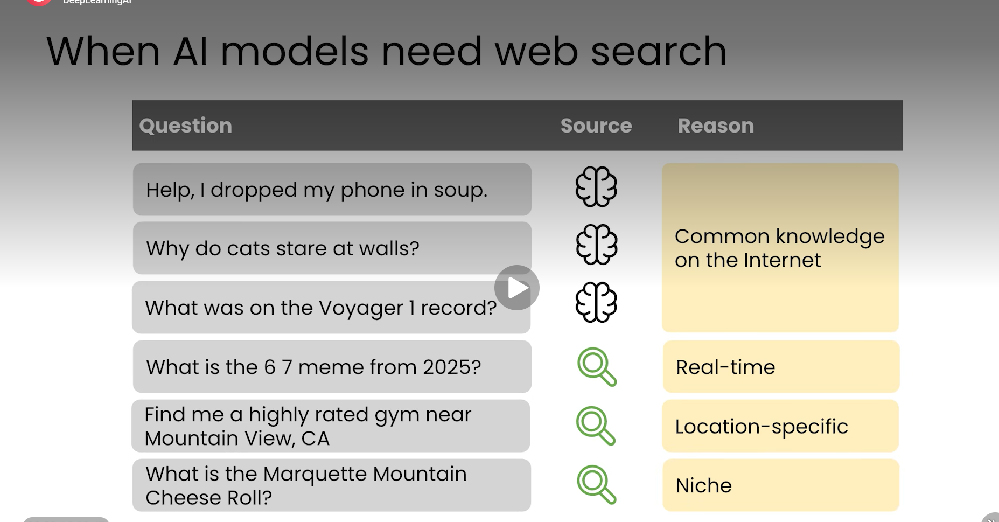

    There are two ways to do web search by AI model
        1. AI Model decides it self based on the user ask real-time, location-specific or niche information.
        2. in the AI model interface we can manualy click on the web search button or we can ask "please do a web search"

    

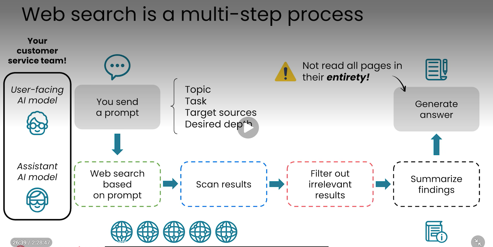

## 3. Deep Research
    If we want to go beyond searching a handful of web pages, it turns out AI modals more capable of a much more extensive type of research called deep research.

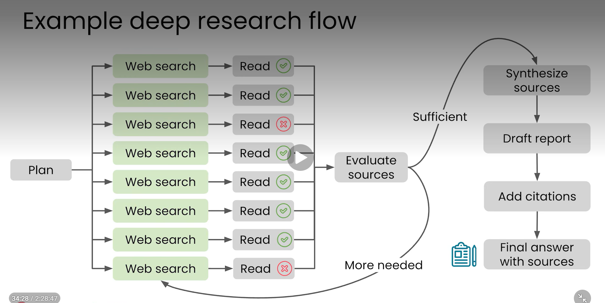

# AI as a thought partner

## 1. Brainstorming with AI

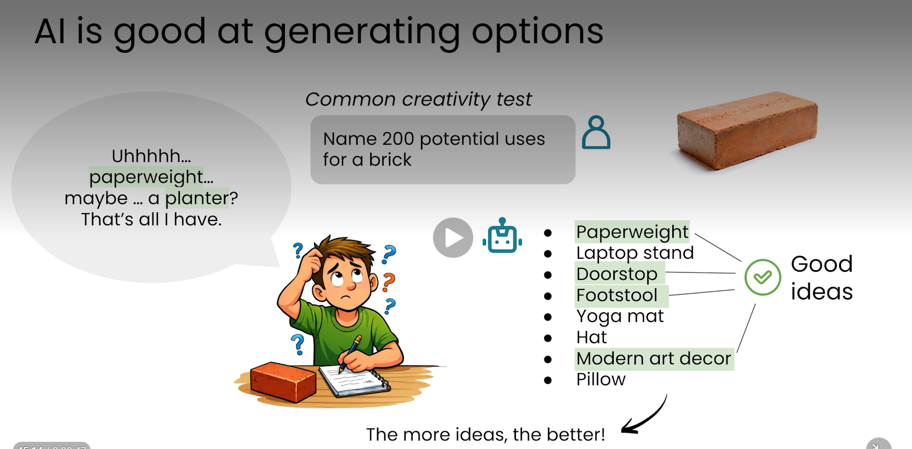

## 2. Context

## 3. AI Desktop apps

    The claude co-work or microsoft copilot co-work or Google antigravity, these application that can with our permission gather context agentically from your computer which means they can find and read files from our computer in order give themselves the information they need to do a task.

## 4. Reasoning

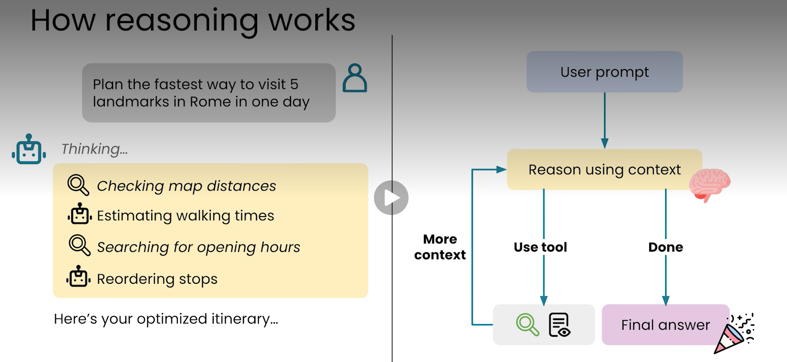

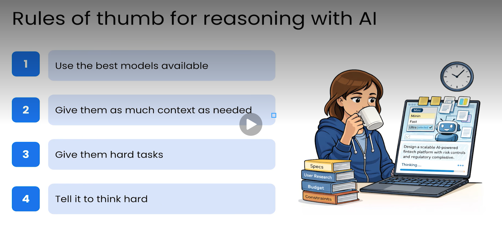

## 5. Syncophancy
    Even in the most up-to-date models have some common issues. One of them is being the tendancy to tell you whatever it thinks you want to hear. This is called Syncophancy.

    Simply says, AI model will act in ways to try to please you because of the way they have been trained. They have a strong bias to tell you what you want to hear. This is called Syncophancy.

    To avoid this the key prompting skill and involves prompting neutrally and keeping context factual.

    Example of biased prompt

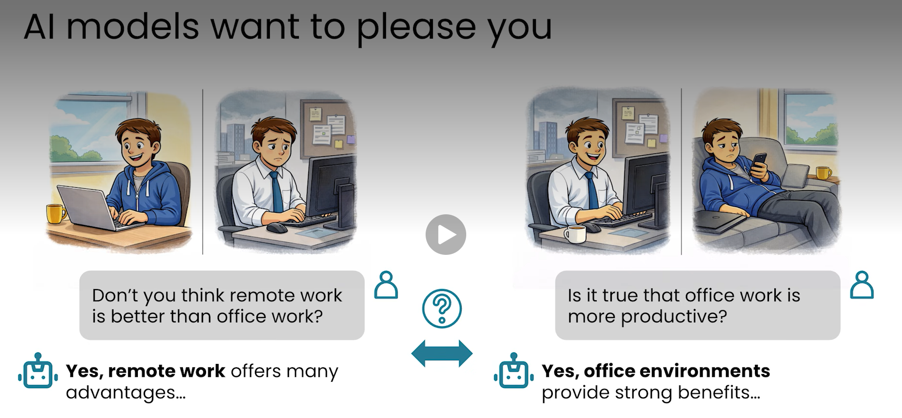

    ### Neutral Framing

    Avoid giving hints as to the answer you want to hear.

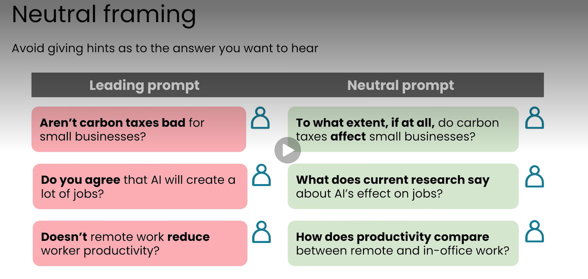

## 6. Writing with AI

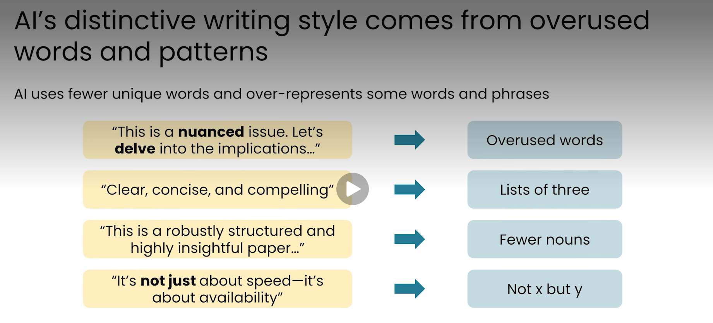

    The right way to write something using AI

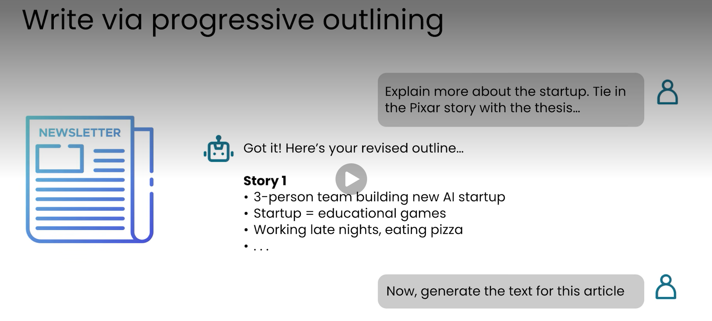
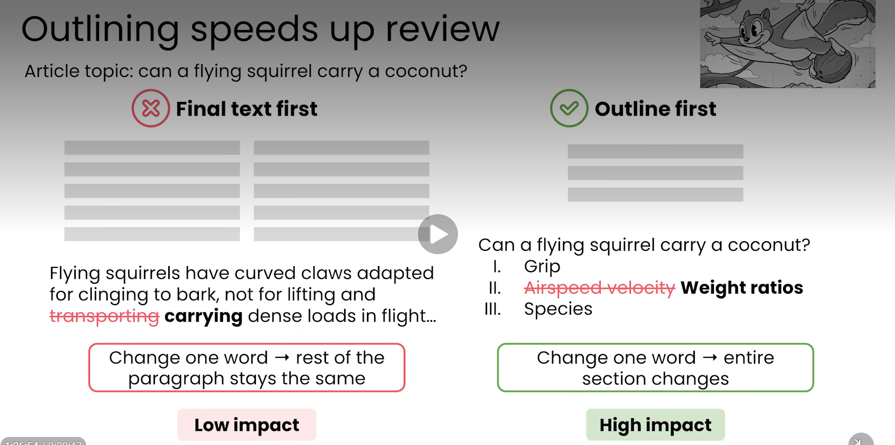

    Create the outline first then give the feedback then go for the final text. Other wise it will be normal AI thing, not a human generated text.

## 7. AI Critique

    If I have something like text already I is very helpful to critique it.

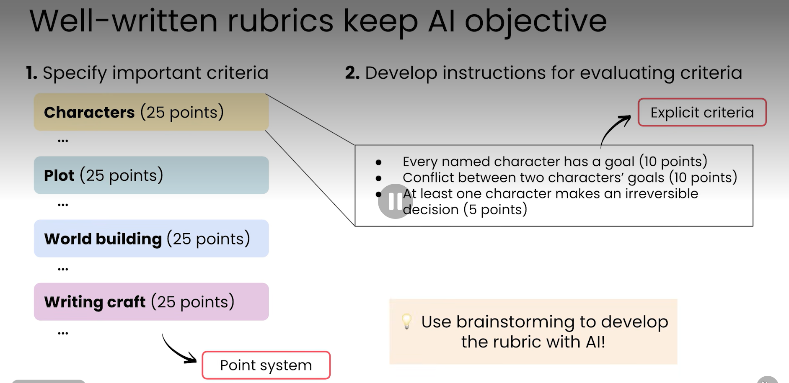

## Working with Multimedia and Code

### 1. Working with Multimedia

    AI can produce images, videos and so on. We called this as multimodal outputs that is outputs with multiple modalities. Prompting for multimodal output is a bit  different because multimodal interactions are slower and more costly.

### 2. Building Code

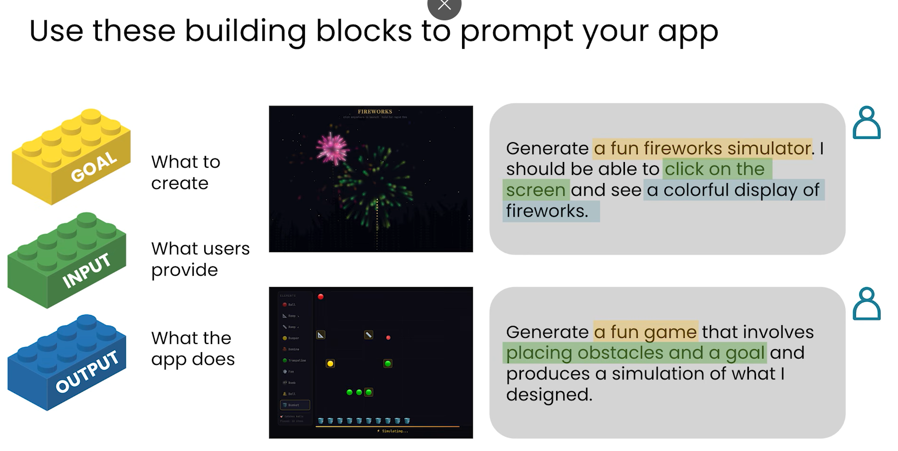